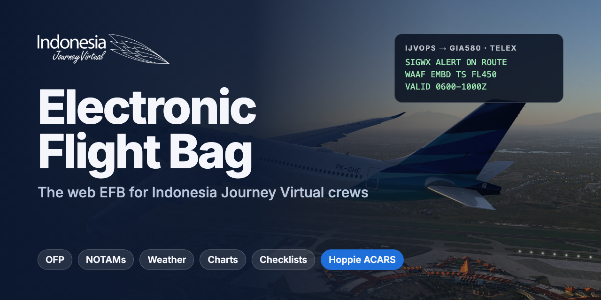

# IJV Electronic Flight Bag

The web EFB for Indonesia Journey Virtual crews. Pilots sign in with vAMSYS, import their latest SimBrief dispatch and fly with the OFP, NOTAMs, weather, charts, checklists and Hoppie ACARS in one tab.

Live at [efb.ijvirtual.org](https://efb.ijvirtual.org).

## Features

- **Flight Folder:** imports the latest SimBrief dispatch. It shows the briefing, fuel, weights, the route and NOTAMs, and exports the IJV-styled OFP as a PDF.
- **Weather:** METAR and TAF for the departure, destination and alternates, decoded, from aviationweather.gov.
- **Charts and checklists:** PDF libraries served from `charts/` and `checklists/`.
- **Performance tools:** quick calculators for the flight deck.
- **Hoppie ACARS** (opt-in on the login page):
  - **SIGWX watch:** checks the planned route and altitude against international SIGMETs and telexes new hits to the aircraft.
  - **One-tap uplinks:** weather, OFP summary, NOTAM digest and a "new dispatch issued" notice.
  - **OOOI times:** OUT, OFF, ON and IN times are read from the crew's downlinks.
  - **Request poller:** the `hoppie-poller` container answers `WX`, `METAR` and `TAF` telexes sent to the ops station with a METAR and TAF.

## Stack

| Part | Tech |
| --- | --- |
| Backend | PHP 8.4 on Apache (`index.php` login, `ops/index.php` API and app shell) |
| Frontend | React 19, Vite, Tailwind 4, Radix UI (`ui/`, built into `ops/ui/`) |
| OFP PDF | Private WeasyPrint renderer (`ops/ijv-efb-dispatch/`), falling back to Dompdf |
| ACARS | Hoppie ACARS, through the PHP client `ops/hoppie.php` and the poller `docker/hoppie_poll.php` |

## Running it

```bash
printf "HOPPIE_LOGON=your-logon\nOFP_RENDER_TOKEN=\n" > .env   # see the table below
docker compose up -d --build
```

The EFB listens on `127.0.0.1:8081`. Put a reverse proxy with TLS in front of it.

| Variable | Default | Purpose |
| --- | --- | --- |
| `EFB_PORT` | `8081` | Local port |
| `VAMSYS_CLIENT_ID` | `867` | vAMSYS OAuth client |
| `VAMSYS_REDIRECT_URI` | `https://efb.ijvirtual.org/index.php` | OAuth callback |
| `OFP_RENDER_URL` | `http://ofp-renderer:8502/render` | WeasyPrint renderer |
| `OFP_RENDER_TOKEN` | empty | Renderer token; leave empty to use Dompdf only |
| `HOPPIE_LOGON` | empty | Hoppie logon code; leave empty to hide the ACARS features |
| `HOPPIE_STATION` | `IJVOPS` | Callsign that telexes are sent from |
| `OPENAIP_API_KEY` | empty | Enables the OpenAIP aviation overlay in Navlog. Create a key under API Clients in your OpenAIP profile and set it in the server's `.env`. |

Keep `.env` out of git. The Hoppie logon never reaches the browser.

The optional Navlog overlay uses the [OpenAIP Tiles API](https://docs.openaip.net/?urls.primaryName=Tiles%20API) under [CC BY-NC 4.0](https://creativecommons.org/licenses/by-nc/4.0/). The EFB serves the tiles through an authenticated endpoint and keeps the OpenAIP key server-side.

## Production deployment

Pushes to `main` on Gitea deploy to `naspad-server` through the repository runner labeled `ijv-efb-production`. The workflow passes the commit SHA to `/usr/local/sbin/deploy-ijv-efb`, installed from `docker/deploy.sh` by the server administrator. If that script changes, update the installed copy on the server before relying on the new behavior.

The script reads the local Gitea repository, builds the revision, and waits for Compose to report the services ready. It keeps using `/opt/ijv-efb/.env` and the existing `ijv-efb` project volumes and network. The last successful release is at `/opt/ijv-efb/current`.

## Development

```bash
cd ui
npm install
npm run dev
node --test src/dispatch.test.js
```

## License

[GNU General Public License v3.0](LICENSE). Bundled Dompdf is under the LGPL; see `ops/dompdf/`.
